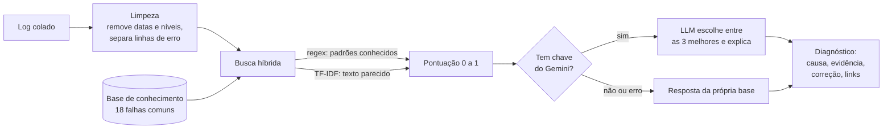

# Airflow Log Assistant

Assistente que lê o log de uma tarefa do **Apache Airflow** que falhou, encontra a causa provável numa base de falhas comuns de **Airflow e Google Cloud** e explica como corrigir. Usa busca híbrida (RAG) e, quando há chave de API, uma LLM (Google Gemini) para escrever o diagnóstico.


## O problema

Quem mantém pipelines de dados passa boa parte do tempo lendo logs longos para descobrir por que uma tarefa caiu. Muitas falhas se repetem: falta de memória, permissão no IAM, tabela inexistente, esquema que mudou. O assistente encurta esse caminho: aponta a causa, mostra a linha do log que comprova e lista os passos de correção, com link para a documentação oficial.

## Como funciona



1. **Limpeza** ([`preprocess.py`](assistant/preprocess.py)): remove os prefixos de data e nível do Airflow, separa as linhas com sinal de erro e a última exceção.
2. **Busca híbrida** ([`retriever.py`](assistant/retriever.py)): cada falha da base recebe uma nota que combina:
   - **padrões (60%)**: expressões regulares de mensagens clássicas, como `SIGKILL` ou `AirflowTaskTimeout`. Um padrão na linha final da exceção vale o dobro.
   - **texto (40%)**: similaridade TF-IDF por n-gramas de caracteres entre o log e a descrição da falha.
3. **Geração** ([`llm.py`](assistant/llm.py)): a LLM recebe só o trecho do log e as 3 falhas recuperadas, com a regra de usar apenas esse contexto. A resposta vem em JSON e é validada: se a LLM citar uma falha que não estava no contexto, a resposta é descartada.
4. **Plano B**: sem chave, com erro de rede ou quota, o assistente responde com a própria base.
5. **Saber dizer "não sei"** ([`diagnose.py`](assistant/diagnose.py)): se nenhum padrão aparece no log ou a nota fica abaixo de 0,40, o assistente informa que não reconhece a falha, em vez de chutar.

## Resultados

Avaliação no modo **somente busca** (sem LLM), com `python -m eval.evaluate`. Resultado completo em [`eval/results.md`](eval/results.md).

| Conjunto | Logs | Acerto top-1 | Causa certa entre as 3 primeiras |
| --- | --- | --- | --- |
| Desenvolvimento | 25 | 100% | 100% |
| **Holdout** | 8 | **75%** | **88%** |

- **Desenvolvimento:** logs usados para escrever a base e calibrar as notas. O 100% é otimista por definição.
- **Holdout:** logs escritos depois e nunca usados para ajustar padrões ou pesos. É o número que estima o desempenho real.

O que o holdout ensinou:
- Na primeira rodada, o holdout acertou **62%** e revelou um defeito: o assistente nunca dizia "não sei". A nota de texto era relativa ao melhor resultado, então sempre havia um "vencedor". A correção foi usar a similaridade absoluta e exigir ao menos um padrão conhecido. Os limites foram calibrados com 3 falhas desconhecidas do conjunto de desenvolvimento, não do holdout.
- Os 2 erros restantes foram mantidos de propósito, sem ajuste, porque mostram limites reais:
  - **Quota do BigQuery** chega como `403 Forbidden` e é confundida com falta de permissão no IAM. A causa certa aparece em 2º lugar.
  - **Erro de certificado SSL** não está na base, mas `HTTPSConnectionPool` casa com o padrão `pool`. A nota fica baixa (0,46), mas passa do limite.

## Como rodar

Requer Python 3.11 ou mais recente.

```bash
git clone https://github.com/MillenaOliveiraSouza/airflow-log-assistant.git
cd airflow-log-assistant
python -m venv .venv
source .venv/bin/activate        # Windows: .venv\Scripts\activate
pip install -r requirements-dev.txt

python app.py                    # abre a interface em http://127.0.0.1:7860
pytest -q                        # roda os testes
python -m eval.evaluate          # mede o acerto nos logs de exemplo
```

Para usar a LLM, crie uma chave gratuita no [Google AI Studio](https://aistudio.google.com/apikey) e defina a variável antes de rodar:

```bash
export GEMINI_API_KEY="sua_chave"        # Windows PowerShell: $env:GEMINI_API_KEY="sua_chave"
python app.py
python -m eval.evaluate --llm            # avaliação com a LLM
```

## Estrutura

```
assistant/
  knowledge.py     carrega e valida a base de conhecimento
  preprocess.py    limpa o log e separa as linhas de erro
  retriever.py     busca híbrida (regex + TF-IDF)
  llm.py           prompt, chamada ao Gemini e validação do JSON
  diagnose.py      orquestra o fluxo e decide quando dizer "não sei"
data/
  knowledge_base/  18 falhas comuns de Airflow e GCP (YAML)
  sample_logs/     logs sintéticos de desenvolvimento e holdout
eval/              script e resultados da avaliação
tests/             testes automatizados (pytest)
app.py             interface Gradio
```

## Decisões técnicas

- **TF-IDF em vez de embeddings:** com 18 documentos curtos, TF-IDF é instantâneo, roda sem GPU nem download de modelo e é fácil de explicar. N-gramas de caracteres lidam bem com nomes como `AirflowTaskTimeout`. Com uma base maior, o próximo passo é trocar por embeddings e um banco vetorial.
- **Regex junto com a busca de texto:** mensagens de erro do Airflow e do Google Cloud são muito padronizadas; um padrão exato é um sinal mais forte que semelhança de texto.
- **LLM só escolhe entre opções recuperadas:** reduz respostas inventadas e permite validar a saída automaticamente.
- **Logs sintéticos:** nenhum dado de empresa ou cliente foi usado. Os textos da base foram escritos para o projeto, com links para a documentação oficial.

## Limitações e próximos passos

- Conjuntos pequenos e sintéticos; o próximo passo é coletar logs públicos de issues do Airflow para um teste maior.
- Ampliar a base com falhas de quota, SSL e disco cheio, que hoje erram ou caem em "não sei".
- Dar pesos diferentes para padrões genéricos (`pool`, `403`) e específicos (`AirflowSensorTimeout`).
- Medir a avaliação com a LLM ativa e comparar com o modo só busca.
- Ler logs direto da API do Airflow, em vez de colar o texto.

## Autora

**Millena Oliveira Souza** · Estudante de Engenharia de Software · [LinkedIn](https://www.linkedin.com/in/millena-oliveira-souza/)

Licença [MIT](LICENSE).
